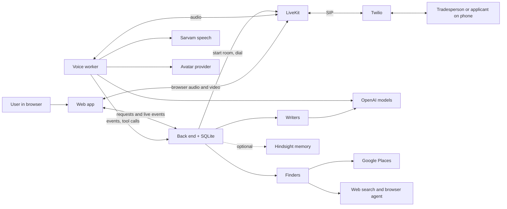
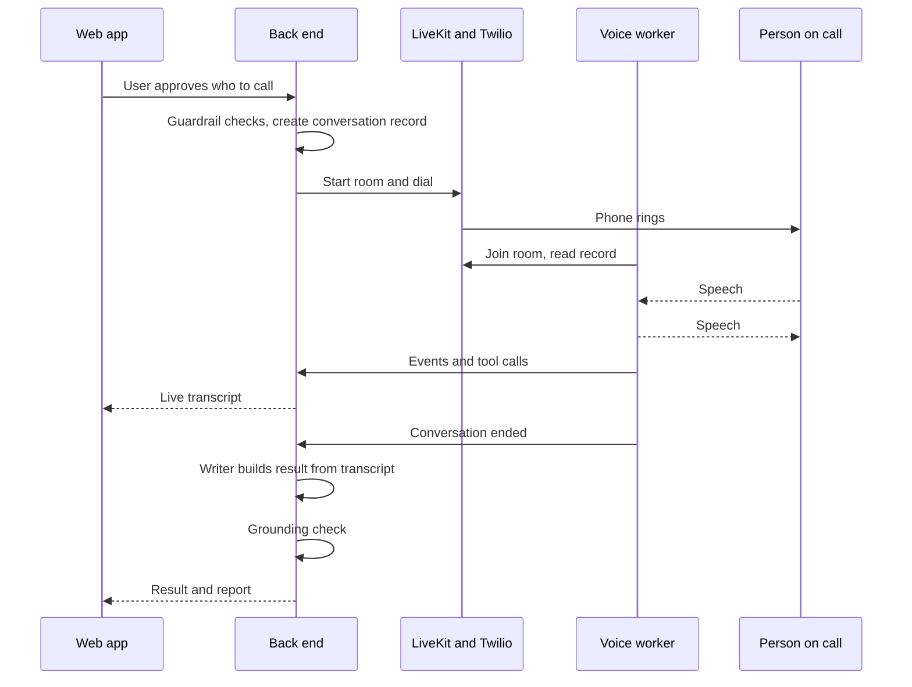

# AgentHire — High-Level Design

Agreed on Sat 21 Nov 2026, about 3:25 PM IST. Read `SCOPE.md` for what is built and `TECH_STACK.md` for what it is built with. This document says how the parts fit together.

## 1. Components

| Component | Job |
|---|---|
| **Web app** | Everything the user sees: voice brief, lists of people, approvals, live transcripts, reports, the apply page and the interview page |
| **Back end** | Stores everything, runs the steps of each side in order, enforces the guardrails, and pushes live events to the web app |
| **Voice worker** | Holds every conversation: voice brief, home-side call, screening call, avatar interview |
| **Finders** | Get people. Home side: Google Places, then JustDial and Urban Company. Company side: web search only (no browser agent; decided Sun 22 Nov) |
| **Writers** | Turn text into structured output: job description, questions, resume fields, call results, scores, reports |

Outside services: LiveKit, Twilio, Sarvam, OpenAI, Google Places, the avatar provider, AWS SES, and optionally Hindsight.

### Layers

The application follows a 3-tier shape (front end, back end, database). A voice product adds two layers that sit outside that request-and-response path: a media layer that carries audio, and an agent layer that holds a live conversation for minutes at a time. This is the same five-layer shape as SevaMitra.

| Layer | Component | Responsibility |
|---|---|---|
| Front end | Web app (React) | Everything the user sees and approves |
| Real-time media | LiveKit room (hosted), with Twilio for the phone line | Carries audio, and avatar video, between the browser or phone and the agent |
| Agent | Voice worker (Python) | Holds one conversation: speech in and out, the conversation engine, its tools |
| Back end | FastAPI service | Job steps, guardrails, finders, writers, memory, the event stream |
| Data | SQLite | Jobs, people, conversations, events, facts, messages |

Two differences from SevaMitra, both deliberate:

- **The back end decides, the worker converses.** In SevaMitra the voice worker held the agent graph and the policy gate. Here the back end owns the order of steps and the guardrails, and the worker only holds the conversation it is given. That is what lets one worker serve home-side calls, screening calls and interviews.
- **No mock services.** The back end reaches real services through the finders.

### Running processes

| Process | Runs | Talks to |
|---|---|---|
| Back end | One FastAPI app on port 8000 | SQLite, LiveKit's API, Twilio (SMS), Google Places, OpenAI, the web app |
| Voice worker | One LiveKit agent worker | LiveKit, Sarvam, OpenAI, the avatar provider, the back end |
| Web app | Vite dev server on port 5173 while building; built files served by the back end when deployed | The back end and LiveKit |

Finders, writers and the conversation engine are Python libraries, not services. The voice worker, the text-mode runner and the eval runner all import the same conversation engine.

### Layer rules

- **The web app never reads or writes the database.** It uses the back end's endpoints and the event stream.
- **The back end is the only owner of the database.** The voice worker reaches data only through the back end.
- **Only the back end starts a call.** Every dial goes through its guardrail check; the voice worker never places a call on its own.
- **The voice worker never decides what happens next.** It is handed a conversation record, holds that conversation, and reports events and tool calls back.
- **Finders and writers never talk to the user or the voice worker.** A finder returns people and a writer returns a typed object, both to the back end.
- **The conversation engine has no LiveKit code in it,** so it runs the same in a phone call and in text mode.

## 2. How a conversation works

All four kinds of conversation follow the same five steps. Only the conversation record differs.

1. The back end creates a **conversation record** holding its kind, language, goal, the facts to collect, and what may be shared.
2. The back end asks LiveKit to start a room and, for a phone call, to dial the number into it.
3. The voice worker joins, reads the record, and talks.
4. Every sentence and tool call is sent to the back end as an event, which is stored and pushed to the web app. That is the live transcript.
5. When the conversation ends, a writer reads the full transcript and produces the structured result.

| Conversation | Who is on the other end | Channel | Language |
|---|---|---|---|
| Voice brief | The user | Browser | Telugu, Hindi or English |
| Home-side call | A tradesperson | Phone | Telugu or Hindi |
| Screening call | A job applicant | Phone | English, understands mixed speech |
| Avatar interview | A shortlisted candidate | Browser with avatar video | English |

## 3. The two sides as chains of steps

- **Home:** brief → find → approve → call (up to three, one after another) → report → pick → confirm.
- **Company:** brief → job description → approve → source → invite → apply → approve → screening call → shortlist → approve → avatar interview → final report.

The back end tracks each request as a **job** with a current step. The web app shows whichever step the job is on. Every "approve" and "pick" is a point where the job waits for the human.

## 4. Key design decisions

1. **One conversation engine, driven by data.** Neither side is written into the voice worker. This is what makes the company side cheap to add after the home side.
2. **The back end owns the order of steps, not the model.** The model talks and writes; code decides what happens next.
3. **Results come from the transcript.** Every price, time and quote in a report can be traced to a line in a call.
4. **Guardrails sit in the back end,** at the point where a number is dialled or a result is saved, so no prompt can bypass them.
5. **Everything is an event.** One stream feeds the live transcript, the history page, the evals and debugging.
6. **One user, one active job per side, one call at a time.** Enough for the demo and much simpler than running calls in parallel.
7. **Kept simple on purpose:** the agent does not use one provider's quote to negotiate with another, and scoring does not learn from the hiring manager's decisions.

## 5. Conversation core

Conversation, context, memory and seamless communication are the core of the product.

### Conversation

Each conversation is driven by a goal and a list of facts to collect, not a script. The agent tracks which facts it has, asks only for what is missing, handles side questions, and ends when the list is complete.

### Context

| Layer | What it holds | Example |
|---|---|---|
| Within a call | The transcript so far and the facts collected | Not asking for the visiting charge twice |
| Across one job | What earlier conversations in the same job found | The avatar interview opens with what the candidate said on the screening call |
| Across jobs | Memory | "Call the same electrician as last time" |

### Memory types

| Type | What it means here | Where it lives |
|---|---|---|
| **In-context** | What the model sees on this turn: the goal, the facts collected so far, and the recent transcript | The prompt |
| **Runtime** | Live state of the call: current step, facts still missing, mood, timers | The voice worker, mirrored as events |
| **Short-term** | Shared across the conversations of one job: earlier call results, screening answers carried into the interview | The job record in SQLite |
| **Episodic** | What happened: each conversation's transcript, events and outcome | The event log in SQLite |
| **Long-term** | Durable facts and preferences about a user, a provider or a candidate | Fact tables in SQLite, with Hindsight on top if needed |

What is remembered long-term:

- **About the user:** area, language, usual time window, providers used before.
- **About a provider:** the language they spoke, what they quoted, whether they picked up, and whether they asked not to be called.
- **About a candidate:** screening answers, carried into the interview.

Memory is recalled before a conversation starts and saved after it ends, never in the middle of a turn, so it adds no delay to a call.

SQLite covers all five types on its own. Hindsight (retain, recall, reflect) is optional and would improve recall over episodic and long-term memory. If it is unreachable, the SQLite facts still work, so a call never fails because of memory.

### Seamless communication

- The turn-taking settings in `TECH_STACK.md`, including never treating "haan" or "ఆ" as an interruption.
- Replies streamed as they are generated.
- The first sentence prepared while the phone is still ringing.
- A short spoken filler when a lookup takes more than about two seconds.
- A polite "could you repeat that?" when speech is unclear, instead of guessing.

### Emotion

- **Hearing it.** The agent reads mood from the other person's words and pace (hurried, irritated, confused, friendly) and adapts: shorter sentences for someone in a hurry, an apology and a quick close for someone irritated, slower rephrasing for someone confused.
- **Speaking it.** Sarvam's current voice model has no emotion setting. It offers pace, an expressiveness dial and a choice of voices. Emotion therefore comes from the wording, the pace and the voice chosen.
- **Limit.** Mood is read from words, not from tone of voice. Detecting emotion from audio is not in this design.

| Quality | Minimum | Fuller version |
|---|---|---|
| Context | Within a call and across one job | — |
| Memory | User and provider facts in SQLite | Hindsight on top |
| Emotion | Expressive voice plus mood-aware wording | Per-turn mood changing pace |

## 6. Structured data

Every hand-off between components is a typed object, never free text that code has to interpret.

- **The objects:** brief, person, conversation record, call result, comparison, job description, screening result, interview result, candidate report.
- **Model output:** anything a model produces for code to use comes back in a fixed schema.
- **Free text exists in only two places:** what is spoken aloud, and the transcript.

The fields of each object are defined in the LLD.

## 7. Tool calls

The voice agent has a small set of tools, and the back end runs them:

- record a fact (for example, the visiting charge);
- mark an outcome (available, not available, wrong number, call the customer back);
- mark do-not-call;
- move to the next question (screening and interview);
- end the conversation.

The exact list and arguments are in the LLD.

## 8. Guardrails

| When | Enforced by | What |
|---|---|---|
| **Before dialling** | Code | Test mode, approved numbers only, calling hours, do-not-call list, a cap on calls per job, demo routing |
| **During the call** | Prompt and code | Opens as an ordinary caller, straight to the work and the area, and the opening cannot be interrupted; never claims to be human, says it is an AI if sincerely asked, and never invents a name or identity; no full address or number before booking; no payments; a time cap per call; ends politely on hostility; ignores attempts by the other person to change its task |
| **After the call** | Code | Every price, time and quote in a result must appear in the transcript, or it is marked unverified and not shown as fact; candidate scores must cite real quotes and never rate accent or fluency |
| **Sourcing** | Code | Sourced candidates are display only; results are never attached to a sourced profile |

## 9. Evals

| Eval | What it checks | Level |
|---|---|---|
| **Scenario suite, text mode** | A simulated tradesperson plays about ten cases (available, busy, wrong number, hostile, replies only in Hindi, asks if it is a robot). Checks the opening covered its requirements, the agent answered honestly when asked, the facts were collected correctly, and no rule was broken | Must |
| **Guardrail tests** | Dialling is blocked outside hours, for unapproved numbers, and in test mode | Must |
| **Extraction accuracy** | Fixed transcripts with known answers produce the right prices and times | Should |
| **Screening suite** | The same scenario approach for candidate calls | Should |
| **Call quality log** | Response delay per turn, interruptions and outcome for each real call, shown on one page | Should |

The eval results also supply numbers for the slides.
